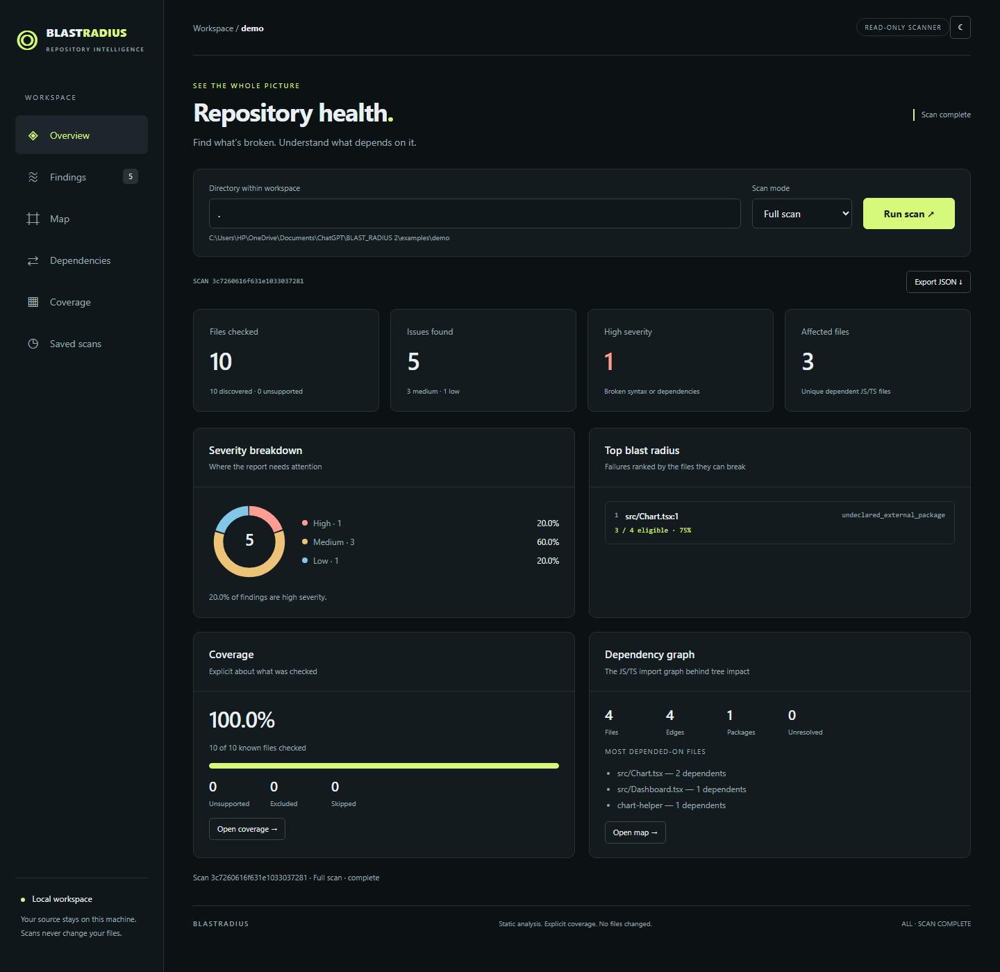

# BlastRadius

[](https://github.com/Taarunkarthik/BLAST_RADIUS/actions/workflows/ci.yml)
[](LICENSE)


> **What's broken in this repository — and how far does the damage spread?**

BlastRadius is a local-first CLI that checks every file it can read and traces how a broken
JavaScript/TypeScript file ripples through the dependency graph. It answers both questions in one
pass, honestly reports what it did *not* check, and never suggests or applies a fix.

Read-only. Offline after setup. Deterministic. No code execution, no network calls during a scan.



## The problem

Today you reach for ESLint, Stylelint, a JSON linter, and a separate graph tool — and none of them
tell you *what depends on the thing that just broke*. BlastRadius does both in a single scan: it
flags the broken file and shows exactly which files it takes down.

## See it work

One undeclared import in `examples/demo` takes down three files:

```text
$ blastradius scan --path examples/demo

BlastRadius Scan - .
Files checked: 10 / 10 (0 not checked)

BROKEN (5 issues)
  HIGH (1)
  src/Chart.tsx:1  undeclared_external_package  chart-helper

TREE IMPACT (how each break propagates)
src/Chart.tsx:1 (undeclared_external_package: chart-helper)
  Impact: HIGH - 3 affected / 4 eligible files (75.0%)
src/Chart.tsx
+-- src/Dashboard.tsx (direct)
|   `-- src/App.tsx (transitive, distance 2)
`-- src/Grid.tsx (direct)
```

The same report also catches a missing CSS import, a broken JSON reference, a missing HTML asset,
and a dead Markdown link — each explicitly tagged **No Tree Impact**, because it is outside the
JS/TS graph.

## What it does

- **Checks every file type it knows:** JS/TS, CSS/SCSS, JSON, YAML, HTML, Markdown, TOML, INI, SVG, Python, and dotenv; optional Bash, SQL, and Mako syntax checks.
- **Builds a real dependency graph** for JS/TS and computes the reverse-dependency *blast radius* —
  affected files, direct vs. transitive, and one shortest path each.
- **Shows it all in a browser:** the optional local harness renders an Overview dashboard with a
  severity donut and top-blast-radius ranking, a searchable findings list with collapsible
  tree-impact detail, a filesystem **Map** of the component tree, and an interactive SVG
  dependency graph — still local and read-only.
- **Uses the real resolver:** nearest `tsconfig`/`jsconfig`, path mappings, package exports, and the
  nearest `package.json` — so aliases and workspaces resolve like your bundler does.
- **Tells the truth about coverage:** unsupported files, size/limit skips, unresolved imports, and
  partial scans are all listed, never hidden.
- **Is deterministic:** `--deterministic-id` produces byte-identical reports, so CI can diff them.
- **Never fixes anything:** it is a diagnostic scanner. No suggestions, no patches, no surprises.

## Try it in 60 seconds

Requirements: Python 3.11+ and Node.js 20+ with npm.

```sh
git clone https://github.com/Taarunkarthik/BLAST_RADIUS.git
cd BLAST_RADIUS
python -m venv .venv
source .venv/bin/activate        # Windows PowerShell: .\.venv\Scripts\Activate.ps1
python -m pip install -e ".[harness]"
blastradius setup                # one-time; after this, scans work offline
blastradius scan --path examples/demo --deterministic-id
```

Prefer a UI? Open the local browser harness:

```sh
blastradius harness --path examples/demo   # then open http://127.0.0.1:8765
```

## Scan your own project

```sh
blastradius scan --path /path/to/repo                       # text report
blastradius scan --path /path/to/repo --mode structure      # graph/impact only
blastradius scan --path /path/to/repo --mode health         # file checks only
blastradius scan --path /path/to/repo --format json --deterministic-id
blastradius --format json --fail-on medium scan --path .    # CI gate
```

Exit codes make it a drop-in CI check: `0` clean · `1` findings at/above the threshold (`high` by
default) · `2` bad invocation or parser failure · `3` incomplete scan (takes precedence).

## Checks and coverage

| Files | Checks |
| --- | --- |
| JS/JSX/TS/TSX/MJS/CJS/MTS/CTS | Syntax, static imports/re-exports/require/dynamic string imports, missing modules, undeclared or uninstalled packages, installed version mismatches |
| CSS/SCSS | Parser syntax errors, local `@import`, Sass `@use`/`@forward`, partial and index resolution |
| JSON | Strict syntax and local `$ref` file/JSON Pointer/anchor targets |
| tsconfig/jsconfig and `.vscode` JSON | JSON-with-comments syntax |
| YAML/YML | Syntax, indentation tabs; multiple documents and custom tags supported |
| HTML | Local asset and page targets, `srcset`, `<base>` |
| Markdown | Local links, images, reference links, and embedded HTML; code examples are excluded |
| TOML | Syntax via Python's `tomllib` |
| INI | Section/key syntax via `configparser`, with interpolation disabled |
| SVG | XML syntax and error lines via ElementTree; scripts and references are not executed or fetched |
| Python | Syntax only via `ast.parse`; no imports, execution, or dependency graph |
| `.env`, `.example`, `*.env`, `*.example` | Basic line format: blank/comment, export declaration, or `KEY=value` |
| Shell (`.sh`, optional) | `bash -n` on bounded stdin when a usable Bash is on PATH; no script execution |
| SQL (`.sql`, optional) | SQLGlot parser diagnostics in its generic dialect; no database access |
| Mako (`.mako`, optional) | Lexer/parser syntax checks; never compile/render a template or execute its Python |

The new TOML, INI, SVG, Python, dotenv, Shell, SQL, and Mako findings have **medium** severity and **No Tree Impact**. Install the optional SQL/Mako parsers with `python -m pip install -e ".[languages]"`; they are not core dependencies. Missing optional parsers leave their file types unsupported, without findings. Shell checks need an actual Bash executable on PATH; Windows' legacy WSL launcher is not accepted as Bash. Unavailable shells stay unsupported, while a running check that times out is disclosed as incomplete coverage.

These are syntax checks, not proof that a program, query, or template is correct. Python syntax follows the scanner's interpreter version. SQLGlot accepts a broad syntax superset and may accept statements a particular database would reject. Dotenv checks are deliberately line-based and do not parse multiline quoted values. Existing ignore rules still apply to `.env` files. `.lock`, `.png`, `.template`, `.vercel`, and extensionless files remain unsupported.

Each issue has a file, line, closed-taxonomy type, severity, target, and impact record. High findings include broken JS/TS syntax/imports. Local configuration/assets are medium; Markdown links are low. An issue retains its severity when the separate graph status says `CRITICAL - root node`.

Non-JS files explicitly report **No Tree Impact**, because they are outside the JS/TS graph. That does not claim that a broken asset has no runtime consequences.

The walker applies built-in exclusions, nested `.gitignore`, and nested `.repohealthignore` patterns. Built-in ignored directories include `.git`, `node_modules`, virtual environments, build output, and caches. Declaration files and symbolic links/junctions are excluded explicitly. Unsupported extensions are counted and listed in every report.

By default a scan checks up to 5,000 eligible files, each up to 2 MB. Increase the bounds with `--max-files` and `--max-bytes`. Files beyond a limit or unreadable text produce a partial report. Missing graph coverage and unsupported resolution are also explicit. Ignored paths are outside coverage and are not counted as checked.

### Exit codes

| Code | Meaning |
| --- | --- |
| `0` | Complete scan with no findings at or above the threshold |
| `1` | Findings meet `--fail-on` (default: `high`) |
| `2` | Invalid invocation, unavailable parser, or scan failure |
| `3` | Incomplete scan; takes precedence over finding thresholds |

`--fail-on none` disables finding-based failure, but still reports incomplete scans as code 3. A parse error is a diagnostic and can also make the graph partial; its high severity determines finding-based failure. Unsupported file types alone do not make a configured scan incomplete.


## Why the output is trustworthy

- **Read-only and local.** Scans never install packages, fetch URLs, run your code, or modify files.
  The only networked step is the explicit one-time `blastradius setup`.
- **Deterministic.** No timestamps or absolute paths in deterministic mode; identical inputs produce
  identical reports, down to the scan ID.
- **Honest.** Coverage is partitioned and disclosed, root-node failures are labelled as graph
  properties (not proof of a runtime entry point), and partial scans never claim a finding was
  resolved.
- **Measured.** CI runs a pinned real-package accuracy corpus (zero unexpected or missed diagnostics
  in the reviewed corpus) alongside unit, integration, and scale tests.

## How it works

```text
Python CLI -> deterministic walker -> file router
                                   |-- TypeScript / PostCSS worker (NDJSON v1, persistent)
                                   |-- Python static file checks + optional language parsers
                                   |-- independent dependency graph
                                   `-- report merger -> Rich text / stable JSON
```

The file checkers and the dependency graph run independently; the report merges them without
mutating either. TypeScript resolution happens in a long-lived Node subprocess that shares caches
across the scan.

## Full reference

- [Implementation phases and status](docs/PHASES.md)
- [Implementation decisions](docs/implementation-decisions.md)
- [Report and worker contract](docs/report-contract.md)
- [Saved scans and comparison (optional PostgreSQL)](docs/persistence.md)
- [Local browser harness](docs/harness.md)
- [Validation results and their limits](docs/validation.md)
- [Product requirements (v3.0)](docs/product-requirements-v3.txt)

**Limits:** this is a static diagnostic MVP — it does not type-check, compile Sass, validate CSS
property values, or prove runtime behavior. Full scope boundaries are in
[the phases document](docs/PHASES.md).

## Development

```sh
pip install -e ".[dev,harness,languages]"
ruff check src tests scripts
python -m mypy src
python -m mypy src --platform linux
pytest -q
python scripts/accuracy.py
```

CI runs Linux, Windows, and macOS across Python 3.11–3.14, plus a PostgreSQL 17 job that exercises
real save/compare workflows and the harness API. The Ubuntu/Python 3.12 job also installs Chromium for the live demo coverage test.

## License

MIT — see [LICENSE](LICENSE). Release history is in [CHANGELOG.md](CHANGELOG.md).
